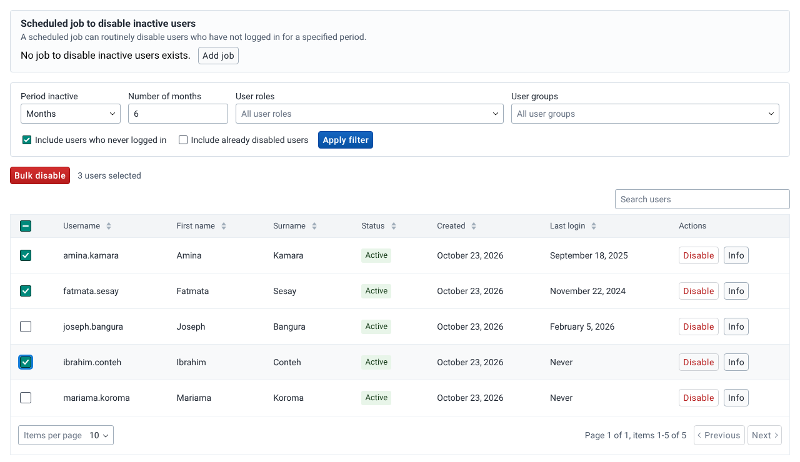
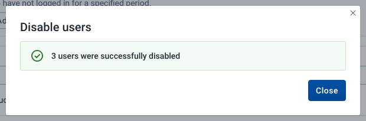

# User Disabler Tool { #tool-user-disabler }

## About the tool { #tool-user-disabler-about }

The User Disabler Tool finds users who have not logged in to DHIS2 for a period that you choose, and disables them one by one or in bulk. It is for system administrators who want only accounts in active use to have access to the system.

## Before you start { #tool-user-disabler-before-you-start }

The tool works with DHIS2 2.41 and later.

You need a user that can update users. DHIS2 lets you disable only the users that you can manage. A superuser with the ALL authority can use every part of the tool.

<!-- VERIFY IN APP: the exact authorities a non-superuser needs to list users, disable users and create the scheduled job. -->

> **Warning**
>
> The tool changes user accounts in bulk. Try it on a copy of your database before you use it on a production server.

## Install the tool { #tool-user-disabler-install }

The tool is not on the App Hub. Install it in one of two ways:

- Download the zip file from the tool's [GitHub releases](https://github.com/dhis2-utils/tool-user-disabler/releases), and upload it in the App Management app.
- Install it from the DHIS2 Admin Toolbox app.

<!-- VERIFY IN APP: the label of the upload control in App Management, 2.41 to 2.43. -->

After you install the tool, add it to the user roles that should open it.

## Find inactive users { #tool-user-disabler-find-users }

The tool opens with a list of the users who have not logged in for 6 months. Users who are already disabled are not in the list.

To change which users the list shows:

1. In **Period inactive**, choose **Months**, **Years** or **Since date**.
2. Enter the number of months or years, or choose the date.
3. Optional: in **User roles** or **User groups**, choose the roles or groups to include.
4. Optional: choose **Include users who never logged in** and **Include already disabled users**.
5. Click **Apply filter**.

The list shows the users that match the filter. To find a user in the list, enter text in **Search users**. To see a user's roles, groups and organisation units, click **Info** in the user's row.

## Disable users { #tool-user-disabler-disable-users }

> **Warning**
>
> A disabled user cannot log in. The tool does not enable users again; to do that, use the Users app.

To disable one user, click **Disable** in the user's row, and then click **Confirm**.

To disable several users:

1. Choose the checkbox in the row of each user. To choose every user that matches the search, choose the checkbox in the table header.
2. Click **Bulk disable**. The dialog shows how many users the tool will disable.
3. Click **Confirm**.

The tool disables the users one at a time and shows the progress. When it finishes, it shows how many users it disabled, and lists each user that DHIS2 refused to disable, with the reason.

Users who are disabled leave the selection. Users that DHIS2 refused stay selected, so you can try again after you fix the cause.

You cannot choose or disable your own account. The tool marks your row with a **You** tag.

## Schedule a job to disable inactive users { #tool-user-disabler-schedule-job }

DHIS2 has a scheduled job that disables users who have not logged in for a number of months. When email is configured, the job also sends users a reminder before it disables them. The tool shows whether the job exists and lets you create it and switch it on or off.

To create the job:

1. Click **Add job**.
2. Enter a **Name**.
3. In **Inactive months**, enter a number from 1 to 24.
4. In **Reminder days before**, enter a number from 1 to 28.
5. In **Cron expression**, enter when the job runs. The default, `0 0 20 ? * *`, runs the job every day at 20:00.
6. Click **Create job**.

To switch the job on or off, use the **Enabled** switch. If more than one job of this type exists, the tool does not show them; manage them in the Scheduler app.

## Known limitations { #tool-user-disabler-limitations }

- The tool loads every user that matches the filter at once. On an instance with very many users, the list can take a long time to load.
- DHIS2 can refuse to disable a user, even for a superuser. For example, on some databases DHIS2 refuses users who are not in a user group that you can manage. The summary lists these users with the reason that DHIS2 gives.
- The tool compares the last login with the date and time on your computer.
- The tool shows and changes only one scheduled job. If there are several, use the Scheduler app.
- The tool cannot enable users. Use the Users app to do that.
- A screen reader does not announce a label for the checkboxes in the user table.
